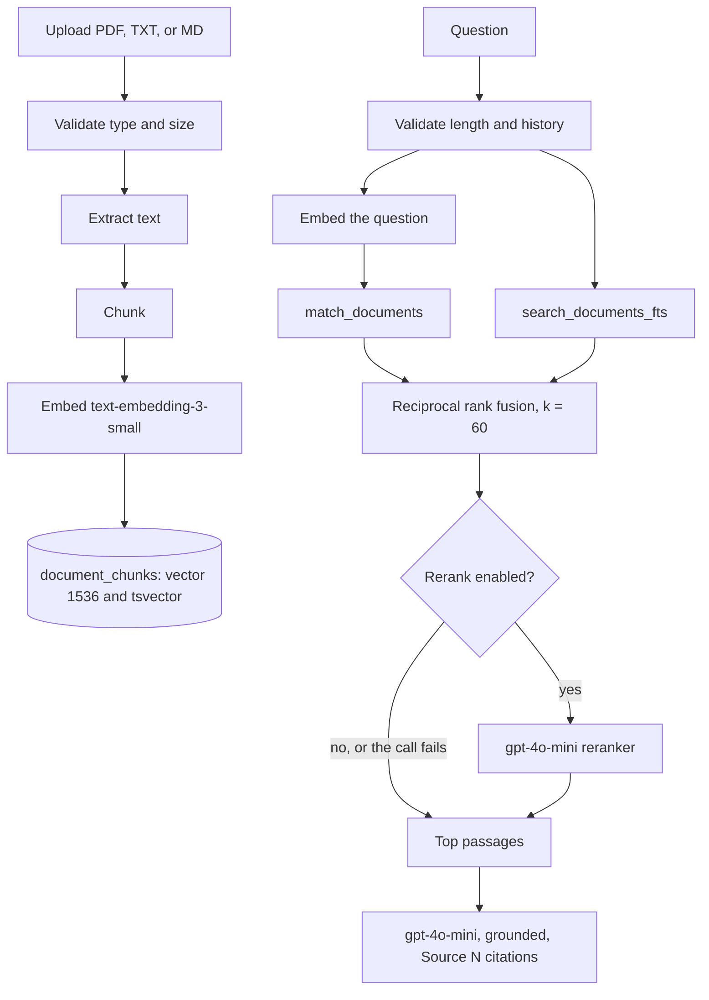

# Insight

Upload a PDF, text file, or Markdown file. Ask a question. The answer is streamed from the passages that were retrieved, with `[Source N]` citations.

The retrieval path is hybrid. A pgvector cosine search and a Postgres full-text search each return a candidate list, and reciprocal rank fusion merges them. An optional reranker sits behind that merge. It is off unless you turn it on, and a failure leaves the fused order in place.

## Architecture



Full-text search runs while the question is being embedded, so the extra round trip overlaps that call. Fusion itself is in process.

## Design

**Vector leg.** Unchanged. `match_documents` in `supabase/migrations/001_initial_schema.sql` ranks by cosine similarity and drops anything at or below 0.3. The ask route still shows six passages to the model.

**Full-text leg.** `supabase/migrations/002_hybrid_full_text.sql` adds a generated `tsvector` on `document_chunks`. Headings are weight A and the body is weight B, so the column cannot drift from the row. `search_documents_fts` ORs the english lexemes of the question. An AND query (`plainto_tsquery` or `websearch_to_tsquery`) returns nothing for a normal question, because no single chunk contains every word, and hybrid search would quietly become vector-only. Stopwords are removed by `to_tsvector`. If the function is missing or errors, the request keeps the vector list and logs the error message only.

**Fusion.** Reciprocal rank fusion, k = 60, lives in `src/lib/rrf.ts`. It does not need the two rankers to share a score scale. The same function runs in the app and in the eval. Ties break by id.

**Rerank.** `src/lib/rerank.ts` defines the interface. The default is a no-op. Set `RERANK_ENABLED=true` with `OPENAI_API_KEY` present, or send `mode: "hybrid-rerank"` to `/api/search`, to score the fused candidates with gpt-4o-mini at temperature 0. A missing key, a bad JSON payload, or a thrown error returns the fused order. `RETRIEVAL_MODE=vector` never reranks. The percent shown on a source card is cosine similarity when the passage came from the vector list. A keyword-only hit is labelled `keyword` rather than given a fake similarity.

**Inputs.** Questions and search queries are trimmed and capped at 2000 characters. History is at most 10 messages. Uploads must be `.pdf`, `.txt`, `.md`, or `.markdown`, at most 10MB, and the mime type must be empty, `application/octet-stream`, or one of the allowed types. Document ids must be uuids. Failures return 400 with a fixed message. Logs do not include the key or the document text.

**Chunking.** `chunkText` is the production chunker and is unchanged. Its size argument is a character budget and its overlap argument is a word count. On a 500-character chunk, a 50-word overlap is a large fraction of the chunk. That is the baseline the eval measures, not a silent "fix". Three strategies are compared:

| Strategy | What it does |
| --- | --- |
| `paragraph-500-50` | Production chunker. 500-character budget, 50-word overlap, paragraph boundaries. |
| `paragraph-1000-100` | Same algorithm, 1000-character budget, 100-word overlap. |
| `heading-aware` | Splits on markdown headings first, then runs the 500/50 chunker inside each section. The heading is stored on every chunk from that section and written once at the start of the section text. |

A paragraph longer than the budget stays in one chunk. The baseline does not split inside a paragraph, and the eval uses the same rule so the comparison is about window size and section boundaries.

## Evaluation

The question set has 42 questions over five public-domain excerpts in `eval/corpus`. Provenance and the editorial changes (line joining, markdown headings on titles the source already had) are in `eval/corpus/SOURCES.md`. A chunk is relevant when its heading or text contains a gold quote. Quotes are unique in the corpus, so a second hit means the overlap copied the quote into a neighbouring chunk.

| Metric | Definition |
| --- | --- |
| Recall@k | Macro-average of relevant chunks in the top k, divided by the number of relevant chunks. |
| MRR | Macro-average of 1/rank of the first relevant chunk in a ranking of depth 20. Missing is 0. |
| Citation accuracy | Of the unique `[Source N]` markers, the fraction that point at a relevant passage among the six the answerer saw. No citations score 0. |
| Faithfulness | Binary verdict that every claim is entailed by the cited passages. Judge failures are left out of the average. |

The grid is the three chunkers crossed with vector, hybrid, and hybrid+rerank.

The judge prompt and its limits live in `src/lib/eval/judge.ts` (`FAITHFULNESS_JUDGE_PROMPT`, `FAITHFULNESS_JUDGE_LIMITS`). In short: the live judge is gpt-4o-mini, so it shares a family with the answer model; the verdict is binary; it sees only cited passages and does not check that the source number is the right one; it moves if the prompt changes. The offline judge is a different thing. A sentence passes when any contiguous 6-word span appears in the cited text, so a true clause glued to a false one can pass. That miss is the `control-glued-clause` item in `eval/judge-controls.json`. The offline judge also only recognises two abstention sentences.

`npm run eval` does not call OpenAI or Supabase. Embeddings are a hashing bag of words, full text is in-memory BM25 with a light stemmer, the reranker counts token overlap, and answers are a sentence copied from the top passage. The production full-text function is still `search_documents_fts`. The harness uses the same fusion, citation parser, and metric functions as the app, with those legs swapped in.

`npm run eval:live` embeds with `text-embedding-3-small`, keeps the 0.3 cosine floor, and uses gpt-4o-mini for rerank, answers, and the judge. The answer prompt is the same system prompt as `/api/ask`. Full text is still the in-memory BM25 stand-in, and the run does not write to Supabase. It needs `OPENAI_API_KEY`. It sends one sequential model call per question per cell, plus rerank calls on the hybrid+rerank cells, so leave a few minutes.

Both commands write `eval/results/latest.json` and `eval/results/latest.md`. The JSON carries the definitions, the judge prompt, and the limits. Read the `mode` field before treating any number as a property of the deployed stack.

## Eval results

Live results are pending a run by the owner. This environment had no `OPENAI_API_KEY` and no database, so this README has no live recall, MRR, faithfulness, or citation figures.

The harness was executed offline. That run writes `eval/results/latest.json` and `eval/results/latest.md` with `"mode": "offline-fixture"`. Those files are a pipeline check. They are not a measurement of OpenAI embeddings, Postgres `tsvector`, or gpt-4o-mini.

To produce the live numbers and replace this note with the table from `eval/results/latest.md`:

```bash
npm run eval:live
```

`OPENAI_API_KEY` must be set. Supabase is not required for that command. Apply `supabase/migrations/002_hybrid_full_text.sql` separately before hybrid search works in the app.

## Tests and CI

Vitest covers chunking, reciprocal rank fusion, citation parsing, request validation, rerank parsing and failure, fusion fallback, and the metric definitions, including a hand-counted ranking. The dataset test checks that every gold quote occurs once. Nothing in the suite opens a network connection or a Supabase client.

GitHub Actions (`.github/workflows/ci.yml`) runs lint, typecheck, unit tests, the offline eval, and the production build on pull requests. It does not use secrets.

```bash
npm run lint
npm run typecheck
npm test
npm run eval
npm run build
```

## Setup

1. Create a Supabase project. Run `supabase/migrations/001_initial_schema.sql`, then `supabase/migrations/002_hybrid_full_text.sql`.
2. Copy `.env.example` to `.env.local` and fill in the Supabase URL, the anon key, the service role key, and `OPENAI_API_KEY`.
3. `npm install && npm run dev`.

`RERANK_ENABLED` is unset by default. Set it to `true` only when you want the extra model call. `RETRIEVAL_MODE` can be `vector`, `hybrid` (the default), or `hybrid-rerank`.

The vector index from the first migration is IVFFlat with `lists = 100`. That setting is a poor fit until the table is large. It is unchanged here because the original migration is left as applied history.
